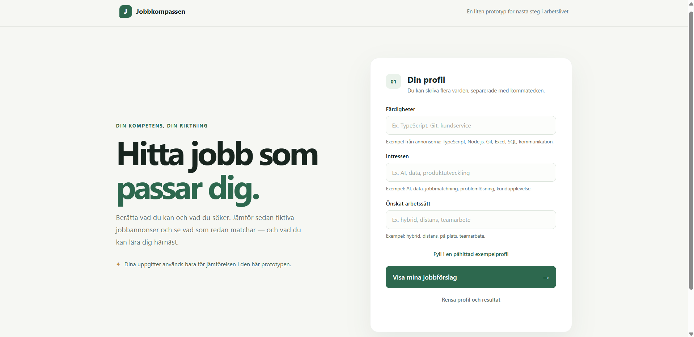
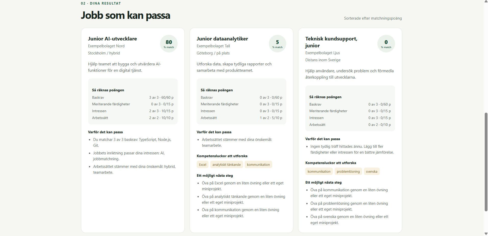

# Jobbkompassen

Jobbkompassen är en portfolio-prototyp som jämför en användarprofil med fiktiva jobbannonser. Projektet utforskar hur en enkel och begriplig matchning kan hjälpa någon att se vilka krav som redan matchar och vad som kan vara nästa steg.

**Prova live:** [Öppna Jobbkompassen](https://jobbkompassen.onrender.com/). Den kostnadsfria Render-instansen kan behöva en kort stund för att starta efter inaktivitet.

## Förhandsvisning

### Startsida



### Exempelprofil


### Matchningsresultat



## Vad appen gör

- Tar emot färdigheter, intressen och önskat arbetssätt.
- Jämför profilen med tre fiktiva annonser.
- Visar totalpoäng, delpoäng, matchande värden och saknade baskrav.
- Ber om minst ett profilvärde innan jämförelsen körs.
- Visar allmänna övningsförslag för saknade baskrav.
- Rensar formuläret och resultatet på användarens begäran.

All matchning är regelbaserad. **Projektet använder ingen språkmodell eller AI-tjänst.** Poängen är en enkel demonstration och inte validerad för verkliga rekryteringsbeslut.

## Teknik

- Node.js 24.12 eller senare
- TypeScript för servern, datatyperna och matchningslogiken
- Node.js inbyggda HTTP-server och testverktyg
- HTML, CSS och vanlig JavaScript för gränssnittet
- TypeScript och Node-typer för statisk typkontroll

## Kom igång

Installera [Node.js](https://nodejs.org/) 24.12 eller senare. Öppna sedan terminalen i projektmappen och kör:

```sh
npm install
npm start
```

Öppna [http://127.0.0.1:3000](http://127.0.0.1:3000). Stoppa servern med `Ctrl+C` i terminalen.

För automatisk omstart när filer ändras:

```sh
npm run dev
```

## Kontrollera projektet

```sh
npm test
npm run build
```

`npm test` kör de tio testerna för matchningsmotorn. `npm run build` kör TypeScript-kompilatorn utan att skapa byggfiler.

## Så räknas matchningen

Appen normaliserar text genom att ta bort inledande och avslutande blanksteg och ignorera skillnader mellan stora och små bokstäver. I övrigt krävs en exakt textträff; till exempel räknas inte `JS` automatiskt som `JavaScript`.

| Kategori | Vikt |
| --- | ---: |
| Baskrav | 60 % |
| Meriterande färdigheter | 15 % |
| Intressen | 15 % |
| Önskat arbetssätt | 10 % |

Varje kategori ger en proportionell del av sin vikt utifrån hur många av annonsens värden som matchar. Resultatet visar hur poängen räknades. Vikterna är en demoheuristik, inte en vetenskapligt validerad bedömning.

## Struktur

```text
docs/                 Arkitektur och projektbeslut
public/               HTML, CSS och webbläsar-JavaScript
src/data/             Fiktiva jobbannonser
src/matching/         Matchningslogik och typer
src/server.ts         HTTP-server och API
tests/                Tester för matchningsmotorn
```

API:t har två anrop:

- `GET /api/jobs` returnerar de fiktiva exempelannonserna.
- `POST /api/matches` tar emot `skills`, `interests` och `preferredWorkModes` och returnerar matchningsresultat.

## Data och begränsningar

- Annonserna och arbetsgivarna är fiktiva.
- Appen hämtar inte riktiga jobbannonser.
- Det finns inga konton eller någon databas; profiluppgifter används för den aktuella jämförelsen och sparas inte av appen.
- Servern begränsar förfrågningar och profilvärden i storlek och antal.
- Projektet är en lärande- och portfolio-prototyp, inte en rekryteringstjänst.
- Använd inte riktiga personuppgifter i demot.

## Min roll och AI-assistans

Jag tog fram projektidén och har styrt mål, funktioner och prioriteringar. Jag har provat appen och gett återkoppling på hur den ska fungera och presentera resultaten. AI-assistans har använts för att utveckla kod och dokumentation. Jag använder projektet för att lära mig mer om TypeScript, Node.js, webbgränssnitt, API:er och testning.